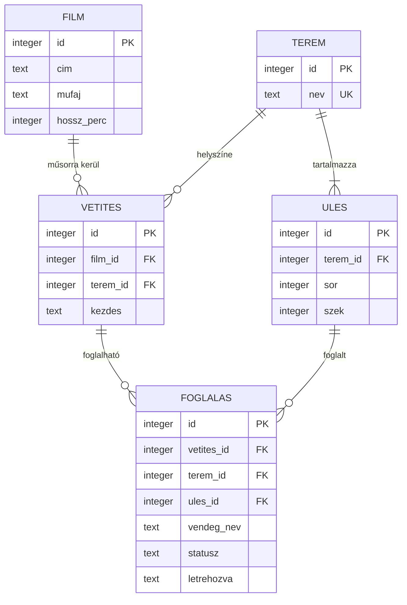

# Adatbázis-séma

Ticket: #4 (1.1 Adatbázis-séma megtervezése)
Megvalósítás: [`db/schema.sql`](../db/schema.sql)

## ER-diagram



## Táblák

| Tábla | Tartalma | Fontosabb szabályok |
|---|---|---|
| `film` | A vetíthető filmek | A hossz pozitív szám |
| `terem` | A mozi termei | A név egyedi |
| `ules` | Egy terem ülései | Egy teremben a sor + szék páros egyedi |
| `vetites` | Egy film adott időpontban, adott teremben | Egy teremben egy kezdési időpontra csak egy vetítés lehet |
| `foglalas` | Egy ülés foglalása egy vetítésre | Egy ülésre vetítésenként csak egy aktív foglalás lehet |

## Tervezési döntések

- **SQLite:** nem igényel külön szervert, és a CI-ban is könnyen futtatható.
- **Dupla foglalás tiltása:** a `foglalas` táblán lévő részleges egyedi index adatbázisszinten akadályozza meg, így az alkalmazás hibája sem okozhat dupla foglalást.
- **Lemondás:** a foglalás nem törlődik, csak `lemondva` státuszba kerül. Az ülés így újra foglalható, a korábbi foglalás pedig visszakereshető marad.
- **Terem-egyezés:** a `foglalas.terem_id` a vetítésre és az ülésre is hivatkozik összetett idegen kulccsal, ezért nem lehet másik terem ülését lefoglalni.
- **Egy foglalás, egy ülés:** a csoportos foglalás több sorból áll. A séma így egyszerűbb, de a csoport tagjait nem köti össze semmi, ezért a lemondás ülésenként történik.
- **Ülések külön táblában:** az ajánló algoritmus a `sor` és `szek` értékekből számolhatja ki, melyik hely van közelebb a terem közepéhez.

## Ismert korlátok

- **Átfedő vetítések:** a séma csak az azonos kezdési időpontot tiltja. Azt, hogy egy vetítés ne kezdődjön egy másik vége előtt ugyanabban a teremben, az alkalmazásnak kell ellenőriznie, mert ez a film hosszától függ.
- **Idegen kulcsok:** az SQLite csak akkor ellenőrzi őket, ha az adott kapcsolaton lefutott a `PRAGMA foreign_keys = ON` parancs.

## Migráció

A séma a [`db/migrate.py`](../db/migrate.py) szkripttel kerül az adatbázisba:

```sh
python db/migrate.py [adatbázis fájl útvonala]
```

Paraméter nélkül a `db/mozi.sqlite` fájlt hozza létre, sikeres futás után pedig kiírja: `Migration finished`.

- **Többszöri futtatás:** a már migrált adatbázist nem módosítja, ezt a `PRAGMA user_version` értéke jelzi.
- **Hiba esetén:** a séma egy tranzakcióban fut le, így nem marad félig létrehozott adatbázis.

A tesztek futtatása:

```sh
pip install -r requirements-dev.txt
pytest
```
